# 🤖 Agent-Builder

<div align="center">


<p>
  
  
  
  
  
</p>

</div>

> A progressive learning repository for building AI agents from scratch, one capability at a time.

---

## 🚀 The Story: How Agent-Builder Grows

This project is not a single agent. It is a structured journey of agent evolution.

Each version adds a new idea, a new capability, and a new level of intelligence.

```text
V1  →  V2  →  V3  →  V4  →  V5  →  V6  →  V7  →  V8  →  V9  →  V10  →  V11  →  V12
│     │     │     │     │     │     │     │     │      │       │       │
│     │     │     │     │     │     │     │     │      │       │       │
Chat  Tools  Action  Plan  Registry  Memory  Safety  Reflection  RAG  Routing  Multi-Agent  Workflow
```

The growth pattern is simple:

```text
Simple response
   ↓
Can use tools
   ↓
Can act on the real world
   ↓
Can plan before acting
   ↓
Can remember and improve
   ↓
Can reason about safety and failure
   ↓
Can retrieve knowledge
   ↓
Can delegate tasks to specialists
   ↓
Can coordinate multiple agents
   ↓
Can automate full workflows
```

---

## 🎯 What this repo teaches

Agent-Builder is a hands-on lab for learning how real agentic systems are built.

It shows the core pattern behind AI agents:

```text
User request
   ↓
LLM decides what to do
   ↓
Tool or action is executed
   ↓
Result is observed
   ↓
Model responds again with better context
```

This repository demonstrates the most important ideas in agent design:

- Tool calling
- File and folder operations
- Planning before execution
- Reusable tool registries
- Memory and persistence
- Safety and approvals
- Reflection and validation
- Retrieval-Augmented Generation
- Routing based on task type
- Multi-agent coordination
- Workflow automation

---

## 🧭 The 12-Version Evolution

Each version solves one core problem and adds one major improvement.

### V1 — Chat Agent

```text
Goal: Let the model talk.

What changed:
- Basic LLM interaction
- Prompt + response loop

Why it matters:
This is the foundation. Before tools, memory, or planning, the agent must know how to respond.
```

### V2 — File Reading Agent

```text
Goal: Let the agent read from the real world.

What changed:
- Added tool calling
- Added file listing and file reading
- Added agentic loop: decide → act → observe → respond

Why it matters:
The model is no longer limited to static replies. It can inspect files and act on real content.
```

### V3 — File Creation Agent

```text
Goal: Let the agent create files and folders.

What changed:
- Added write actions
- Added path management
- Added file creation tools

Why it matters:
Now the agent can produce state changes. It is not just answering — it is creating things.
```

### V4 — Planning Agent

```text
Goal: Make the agent think before acting.

What changed:
- Added planning step
- Break task into smaller steps
- Execute sequentially

Why it matters:
This is where agent behavior becomes more reliable. Instead of jumping directly into actions, it creates a plan.
```

### V5 — Reusable Tool System

```text
Goal: Build a cleaner, scalable tool architecture.

What changed:
- Added a tool registry
- Tools are registered once and reused
- Agent loop becomes cleaner and more modular

Why it matters:
This is a major architecture improvement. Instead of hardcoded action logic, tools become reusable building blocks.
```

### V6 — Memory Agent

```text
Goal: Let the agent remember.

What changed:
- Added short-term memory
- Added persistent memory via SQLite
- Added save/search memory behavior

Why it matters:
The agent can now carry context across sessions and reuse facts later.
```

### V7 — Safety & Human Approval

```text
Goal: Keep agent actions safe.

What changed:
- Added risk classification
- Added approval-required flows
- Added safety checks before sensitive tools run

Why it matters:
This is the step that makes agent systems more responsible. The model must not execute risky actions blindly.
```

### V8 — Reflection & Evaluation

```text
Goal: Let the agent check whether it succeeded.

What changed:
- Added reflection loop
- Added evaluation of result quality
- Added retry logic for failed actions

Why it matters:
The agent becomes less fragile. It learns to verify what happened after an action and fix mistakes when needed.
```

### V9 — RAG Knowledge System

```text
Goal: Let the agent retrieve information from knowledge sources.

What changed:
- Document loading
- Knowledge retrieval
- Context-aware answers from past information

Why it matters:
This introduces memory beyond conversation — access to documents, policy data, and facts from external knowledge.
```

### V10 — Agent Routing

```text
Goal: Decide which specialist should handle the task.

What changed:
- Added router agent
- Task classification
- Delegation to specialist agents

Why it matters:
Instead of one large agent trying to do everything, the system routes tasks to the best specialized handler.
```

### V11 — Multi-Agent System

```text
Goal: Use multiple agents working together.

What changed:
- Added coordinator agent
- Shared state across agents
- Specialized agents collaborate

Why it matters:
This mirrors real-world systems: different agents handle different skills, while a coordinator orchestrates them.
```

### V12 — Workflow Automation

```text
Goal: Turn agent behavior into business-like workflows.

What changed:
- Added workflow execution patterns
- External service orchestration
- Checkpoints and longer-running flows

Why it matters:
This is the move from “single agent response” to “agent-driven automation system.”
```

---

## 🧱 The architecture evolution

```mermaid
flowchart LR
    A[V1: Chat] --> B[V2: Read Tools]
    B --> C[V3: Write Tools]
    C --> D[V4: Planning]
    D --> E[V5: Tool Registry]
    E --> F[V6: Memory]
    F --> G[V7: Safety]
    G --> H[V8: Reflection]
    H --> I[V9: RAG]
    I --> J[V10: Routing]
    J --> K[V11: Multi-Agent]
    K --> L[V12: Workflow Automation]
```



This is the actual story of the repository:

- V1 teaches the basic model loop.
- V2 adds file access.
- V3 adds real-world action.
- V4 adds planning.
- V5 adds structure and maintainability.
- V6 adds persistence.
- V7 adds safety.
- V8 adds self-checking.
- V9 adds external knowledge.
- V10 adds delegation.
- V11 adds teamwork.
- V12 adds system-level automation.

---

## 🔥 Capability growth over time

```text
Capability
   ^
   |
   |                           ████████████████████████  V12 Workflow Automation
   |                    █████████████████████████████  V11 Multi-Agent
   |                 ████████████████████████         V10 Routing
   |              ████████████████████                V9 RAG
   |           ██████████████████                     V8 Reflection
   |        ████████████████                          V7 Safety
   |      ██████████████                              V6 Memory
   |    ████████████                                  V5 Tool Registry
   |  ██████████                                      V4 Planning
   | ████████                                         V3 File Creation
   | █████                                           V2 Tool Use
   | ███                                             V1 Chat
   +--------------------------------------------------> Versions
       1   2   3   4   5   6   7   8   9   10  11  12
```

The pattern is clear: each step adds a new layer of intelligence.

---

## 🧠 Why the repo is valuable

This repository answers the question:

> How do you go from a simple prompt-based model to an autonomous system?

The answer is not a single leap. It is a series of deliberate upgrades:

1. Talk
2. Read
3. Write
4. Plan
5. Standardize
6. Remember
7. Protect
8. Reflect
9. Retrieve
10. Route
11. Coordinate
12. Automate

That is exactly what agentic AI means in practice.

---

## 📁 Repository structure

```text
Agent-Builder/
├── v01_chat_agent/
├── v02_file_reading_agent/
├── v03_file_creation_agent/
├── v04_planning_agent/
├── v05_reusable_tool_system/
├── v06_memory/
├── v07_safety_and_human_approval/
├── v08_reflection_and_evaluation/
├── v09_rag_knowledge_system/
├── v10_agent_routing/
├── v11_multi_agent_system/
├── v12_agentic_workflow_automation/
├── .env.example
├── requirements.txt
├── LICENSE
├── README.md
└── docs / notes / learning files
```

---

## 🚀 Quick start

### 1. Clone the repo

```bash
git clone https://github.com/anushree-011/Agent-Builder.git
cd Agent-Builder
```

### 2. Set environment variables

```bash
cp .env.example .env
```

Then edit your `.env` file:

```env
OLLAMA_API_KEY=your_key_here
OLLAMA_BASE_URL=https://ollama.com/api
MODEL_NAME=gemma4:31b
```

### 3. Install dependencies

```bash
pip install -r requirements.txt
```

### 4. Run a version

```bash
cd v01_chat_agent
python chat_agent.py
```

Or run a more advanced version:

```bash
cd v11_multi_agent_system
python main.py
```

---

## 🧪 What each version feels like in practice

```text
V1: "Hello, model. Can you answer me?"
V2: "Read this file and summarize it."
V3: "Create a folder and write a report."
V4: "Plan and execute this project setup."
V5: "Use the correct tool from the registry."
V6: "Remember that I prefer Python."
V7: "Delete this file only after approval."
V8: "Check whether the file actually got created."
V9: "Use the knowledge base to answer this question."
V10: "Route this request to the right specialist."
V11: "Coordinate file work plus memory work in one task."
V12: "Run a full workflow from API call to result handling."
```

---

## 🏁 The learning mindset

This repo is designed to teach one important truth:

> Agents are not built in one step. They are built by gradually adding capabilities.

The learning progression is not random. Every version solves a core problem:

- V1 solves conversation
- V2 solves access to real data
- V3 solves actuation
- V4 solves planning
- V5 solves structure
- V6 solves continuity
- V7 solves safety
- V8 solves validation
- V9 solves knowledge
- V10 solves delegation
- V11 solves collaboration
- V12 solves automation

That is the real apprenticeship of agentic AI.

---

## 🌟 Final takeaway

Agent-Builder is a blueprint for understanding the evolution from a simple chatbot to a serious AI system.

If you are learning agentic AI, this repository gives you a practical roadmap:

```text
Start simple → add tools → add planning → add memory → add safety → add reflection → add knowledge → add orchestration → automate workflows.
```

This is not just code. This is the story of how AI agents become more capable, more reliable, and more useful.

---

<div align="center">


<p><strong>Built for learning, experimenting, and understanding AI agents.</strong></p>

</div>
