# 🤖 Agent-Builder

<div align="center">



<p>
  
  
  
  
  
</p>

</div>

> From a simple chatbot to a multi-agent workflow system.

<br>

## 🚀 What this repo is

Agent-Builder is a hands-on learning path for building AI agents from scratch.

Instead of jumping straight into a giant framework, this repo teaches the real progression:

```text
Chatbot
   ↓
Can use tools
   ↓
Can read and write files
   ↓
Can plan actions
   ↓
Can remember context
   ↓
Can act safely
   ↓
Can reflect and validate
   ↓
Can use knowledge retrieval
   ↓
Can route work to specialists
   ↓
Can coordinate multiple agents
   ↓
Can automate full workflows
```

Each version adds one important idea, one real capability, and one step toward agentic AI.

---

## 🧭 The 12 versions

| Version | What it does | Main idea |
|---------|--------------|-----------|
| V1 | Chat agent | Basic conversation |
| V2 | File reading agent | Tool use + file access |
| V3 | File creation agent | Real-world actions |
| V4 | Planning agent | Break work into steps |
| V5 | Tool registry | Reusable tool system |
| V6 | Memory agent | Persistence and recall |
| V7 | Safety agent | Approval and guardrails |
| V8 | Reflection agent | Check results and retry |
| V9 | RAG agent | Knowledge retrieval |
| V10 | Routing agent | Send tasks to specialists |
| V11 | Multi-agent system | Coordination between agents |
| V12 | Workflow automation | End-to-end agent orchestration |

---

## 🧠 The core pattern

```text
User request
   ↓
Agent decides what to do
   ↓
Agent calls a tool or action
   ↓
Agent observes the result
   ↓
Agent responds with better context
```

That loop is the heart of agentic AI.

---

## 🛠️ Why this repo is useful

If you're learning AI agents, this repo makes the architecture easy to see:

- how tools are exposed to an LLM
- how agent loops work in practice
- how planning improves reliability
- how memory adds continuity
- how safety prevents dangerous actions
- how reflection improves quality
- how routing and multi-agent systems scale

This is not theory-only code. It is a practical roadmap.

---

## 📁 Repository structure

```text
Agent-Builder/
├── v01_basic_local_agent/
├── v02_file_reading_agent/
├── v03_file_creation_agent/
├── v04_planning_agent/
├── v05_reusable_tool_system/
├── v06_memory/
├── v07_safety_and_human_approval/
├── v08_reflection_and_evaluation/
├── v09_rag_knowledge_system/
├── v10_agent_routing/
├── v11_multi_agent_system/
├── v12_agentic_workflow_automation/
├── assets/
├── .env.example
├── requirements.txt
├── LICENSE
├── README.md
└── docs/
```

---

## ⚡ Quick start

### 1. Clone the repo

```bash
git clone https://github.com/anushree-011/Agent-Builder.git
cd Agent-Builder
```

### 2. Set up environment

```bash
cp .env.example .env
```

Then update your `.env` file with your Ollama settings.

### 3. Install dependencies

```bash
pip install -r requirements.txt
```

### 4. Run a version

```bash
cd v01_basic_local_agent
python basic_agent.py
```

Or try a more advanced version:

```bash
cd v11_multi_agent_system
python main.py
```

---

## 🎯 What you will learn

By the end, you will understand:

- how a basic LLM agent works
- how tools change an AI from passive to active
- how planning improves execution
- how memory creates continuity
- how safety systems make agents responsible
- how agents can reflect and improve
- how RAG extends knowledge beyond a prompt
- how routers and multi-agent systems scale coordination

---

## 🌱 Learning journey

```text
Start simple
   → add tools
   → add planning
   → add memory
   → add safety
   → add reflection
   → add knowledge
   → add routing
   → add collaboration
   → automate workflows
```

This is the real progression from a chatbot to an autonomous system.

---

## 🏁 Final takeaway

Agent-Builder is not just a collection of scripts.

It is a visual and practical roadmap for understanding how AI agents evolve from:

- answering
- to reading
- to acting
- to planning
- to remembering
- to collaborating
- to automating

If you are learning agentic AI, this repo is a clear, step-by-step blueprint.

---

<div align="center">

<p><strong>Build agents step by step.</strong></p>

</div>
