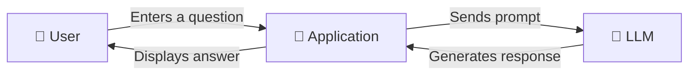

# V1 — Basic LLM Agent 🤖

### Your first step into Agentic AI

---

## 1. What Are We Building?

We are building a simple AI application that accepts a question from the user, sends it to a Large Language Model (LLM), and displays the response.

For example, you enter:

> "Explain Artificial Intelligence in simple English."

The application sends your question to the AI model, receives its answer, and displays it.

This is the foundation for the more advanced agents we will explore in later versions.

## 2. How Does It Work?

The process is simple:

1. The user enters a question.
2. The application prepares the prompt.
3. The prompt is sent to an LLM.
4. The LLM generates a response.
5. The application displays the response.

## 3. Important Concepts

| Concept | Meaning in Simple English |
|---|---|
| Artificial Intelligence (AI) | Technology that performs tasks that normally require human intelligence. |
| Large Language Model (LLM) | An AI model trained to understand and generate language. |
| Prompt | The question or instruction given to the model. |
| System instruction | Instructions that guide how the model should behave. |
| User message | The question or message entered by the user. |
| Model response | The answer generated by the AI model. |
| API | A way for one application to communicate with another service. |
| API key | A credential used to authenticate access to an API. Keep it private. |
| Context | Information available to the model when generating a response. |
| Conversation history | Previous messages that may be included to help the model maintain context. |

## 4. What Is an LLM?

An LLM is an AI model that can understand and generate text.

It can help with tasks such as:

- Answering questions.
- Explaining difficult concepts.
- Summarizing text.
- Generating ideas.
- Writing and reviewing code.
- Translating languages.

An LLM does not automatically know your private files or current information. What it can access depends on the model, the information you provide, and the tools connected to it.

## 5. What Is a Prompt?

A prompt is the instruction or question we give to an AI model.

The quality of the prompt can influence the quality of the response.

**Example 1 — Simple prompt**

"Explain machine learning."

**Example 2 — More specific prompt**

"Explain machine learning in simple English, using three examples suitable for a beginner."

The second prompt gives the model clearer instructions about the explanation and its format.

### Types of Messages

| Message Type | Purpose | Example |
|---|---|---|
| System | Sets general behavior and instructions. | "Explain concepts in simple English." |
| User | Provides the request. | "What is an LLM?" |
| Assistant | Contains the model's response. | "An LLM is an AI model that works with language." |

## 6. What Is an API?

An API allows your application to communicate with an AI service.

Without an API or another model interface, your application needs a different way to access the model.

The basic communication process looks like this:

1. Your application creates a request.
2. The request is sent to the model provider.
3. The provider processes the request.
4. A response is returned to your application.
5. Your application displays the response.

### What Is an API Key?

An API key is used to authenticate your application with a service.

Treat it like a password:

- Never publish it in your GitHub repository.
- Store it in an environment variable or an ignored configuration file.
- Never share it in screenshots or public logs.
- Check the provider's usage limits and pricing before making API calls.

## 7. Different Ways to Connect to an LLM

We can communicate with an LLM in different ways. For this beginner version, we only need to understand the simplest options.

| Approach | How It Works | When Should We Choose It? | Cost |
|---|---|---|---|
| Direct API request | Sends an HTTP request to a model provider. | When we want to understand how API communication works at a lower level. | Depends on the provider and model. |
| Provider SDK | Uses a library provided by the model provider to communicate with its API. | When we want simpler request handling and provider-specific features. | The SDK may be free; model usage may cost money. |

An SDK is a library that makes it easier to communicate with a service. Both approaches can send prompts and receive responses.

## 8. What Are the Limitations of a Basic LLM Agent?

This first version is intentionally simple.

| Limitation | Explanation |
|---|---|
| No independent tool use | It cannot automatically search files or execute tools unless we add that functionality. |
| Limited memory | It may not remember previous messages unless conversation history is provided. |
| No document retrieval | It cannot automatically search your private documents without additional functionality. |
| Possible incorrect answers | An LLM can generate inaccurate or misleading information. |
| External service dependency | An API-based implementation requires access to the provider's service. |
| Usage limits and costs | API requests may have rate limits or charges, depending on the provider. |

These are not failures of the project. They are the reasons we will explore more advanced capabilities in later versions.

## 9. Final Understanding

A basic LLM application follows this simple pattern:

**User question → Prompt → LLM → Response**
