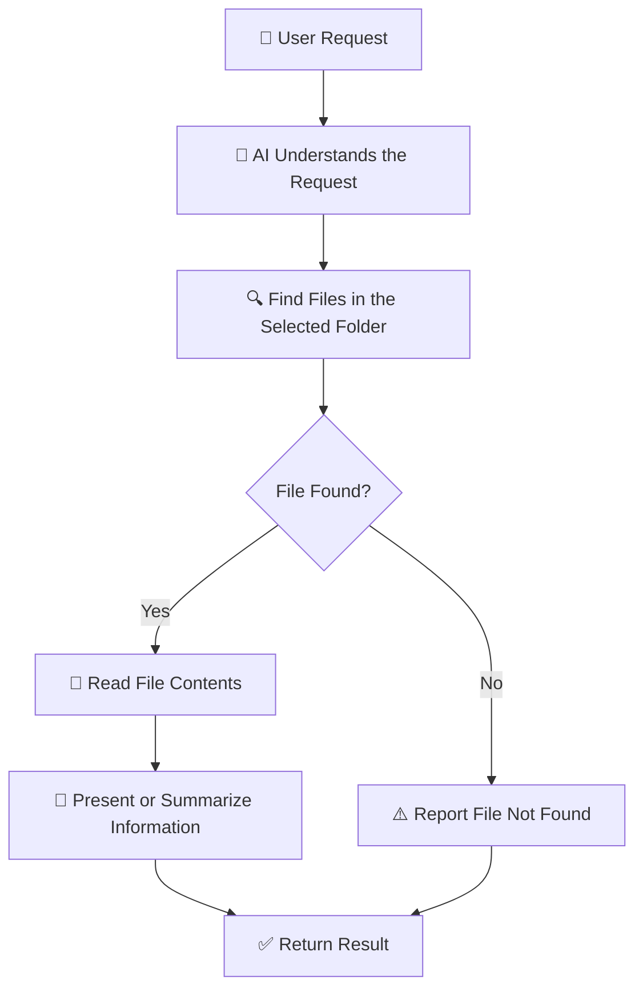

# V2 — File Reading Agent 📂

<div align="center">

## 🧭 Learning Snapshot

```text
User asks: "Find or read a file"
        ↓
Agent locates matches
        ↓
Agent reads allowed files
        ↓
Agent processes content
        ↓
Agent returns useful summary/result
```

**This version teaches the agent to observe and understand files, not just answer questions.**

</div>

---

### Teach an AI agent to find and read files on your computer

---

## 1. What Are We Building?

We are building an AI agent that can locate files in a selected folder, read their contents, and provide useful information about them.

For example, you have a folder containing PDF files, text files, and documents. Instead of searching through them manually, you can ask:

- Find my Java notes.
- Read a text file and summarize it.
- Find files containing a particular keyword.
- List all the files inside a folder.
- Read a document and explain its contents in simple English.

The agent uses file operations to access the files and then processes their contents according to your request.

## 2. How Does It Work?



For example, if you ask the agent to read your Java notes, it identifies the requested file, locates it in the permitted folder, reads its contents, and returns the information.

## 3. Important Concepts

| Concept | Meaning in Simple English |
|---|---|
| File system | The way files and folders are organized on a computer. |
| File path | The location of a file or folder. |
| Directory | Another name for a folder. |
| File search | Finding files that match a name or condition. |
| File traversal | Going through folders and their subfolders. |
| File reading | Opening a file and accessing its contents. |
| File extension | The ending of a filename, such as `.txt`, `.pdf`, or `.docx`. |
| Tool calling | Allowing an AI agent to request that a program perform an action. |
| Error handling | Managing problems such as missing files or unreadable content. |
| Permissions | Rules that determine which files an application is allowed to access. |

## 4. How Can We Find Files?

There are different ways to locate files, depending on what the user requests.

| Search Method | How It Works | When Should We Use It? |
|---|---|---|
| Exact filename search | Looks for a file with a specific name. | When the user knows the filename. |
| Partial filename search | Finds files whose names contain a particular word. | When the user remembers only part of a filename. |
| Extension-based search | Finds files with a specific extension. | When looking for all PDFs, text files, or documents. |
| Recursive search | Searches the selected folder and its subfolders. | When files may be stored inside nested folders. |
| Content-based search | Searches the readable contents of files. | When the user remembers information inside a file but not its name. |
| Metadata-based search | Uses details such as file size or modification time. | When searching for recently modified or unusually large files. |

**Example:**

You ask, "Find all PDF files related to Java."

The agent can first locate PDF files and then, if content searching is supported, inspect their text to identify which ones discuss Java.

Finding a PDF by its filename is different from searching the information inside it.

## 5. How Can We Read Different File Types?

Not every file stores information in the same format.

| File Type | Example | How It Can Be Read |
|---|---|---|
| Text | `.txt` | Read the text directly. |
| Markdown | `.md` | Read the text and Markdown formatting. |
| Python source code | `.py` | Read the source code as text. |
| JSON | `.json` | Read and parse structured data. |
| CSV | `.csv` | Read tabular data using text or a CSV parser. |
| PDF | `.pdf` | Extract text using a PDF-processing library. |
| Word document | `.docx` | Extract paragraphs and tables using a document-processing library. |
| Excel workbook | `.xlsx` | Read worksheet data using a spreadsheet library. |
| Image | `.png`, `.jpg` | Inspect the image or use OCR to extract text. |

Some files require specialized libraries. Scanned PDFs and images may require OCR (Optical Character Recognition), which detects text from images.

A file can exist and still be unreadable if the format is unsupported, the file is damaged, or the application lacks permission to access it.

## 6. What Is Tool Calling?

An AI model can understand a request, but it cannot automatically access your computer's files just because you ask it to.

We must provide functions that allow the application to perform specific operations.

For example:

- `list_files()` — lists files in an allowed folder.
- `search_files()` — finds files matching a condition.
- `read_file()` — reads a permitted file.
- `extract_pdf_text()` — extracts text from a PDF.

The AI can decide which function is appropriate, while the application executes that function and returns its result.

This is called **tool calling** or **function calling**.

The exact function names are design choices; they are examples, not built-in Python functions.

## 7. Different Approaches to File Reading

| Approach | How It Works | When Should We Choose It? | Limitations |
|---|---|---|---|
| **Python file operations** | Uses built-in Python functionality to list, open, and read files. | When learning the fundamentals of file handling. | Specialized formats may need extra libraries.[...] |
| **Operating-system search** | Uses operating-system features to locate files. | When we want to use existing file-search capabilities. | Behavior differs across operating systems. |
| **Content extraction libraries** | Uses libraries to extract text from PDFs, Word documents, and other formats. | When the agent needs to read more than plain text. | Each format may require a specialized reader. |
| **AI-directed tool calling** | The model selects an available file operation based on the user's request. | When users should be able to ask for file operations in natural language. | The model may choose the wrong tool or provide invalid parameters. |
| **MCP (Model Context Protocol)** | Provides a standard way for AI applications to connect to external tools and data sources through MCP servers. | When multiple compatible AI clients need to access the same file tooling. | Requires an MCP server and compatible client setup. |

These approaches can work together. For example, AI-directed tool calling can select a function, and that function can use Python file operations to read the requested file.

## 8. What Can Go Wrong?

| Problem | Example | How Should the Agent Respond? |
|---|---|---|
| File not found | The requested filename does not exist. | Report that the file could not be found. |
| Permission denied | The application cannot access the file. | Explain the access problem without attempting to bypass permissions. |
| Unsupported format | The file type cannot be processed. | Report the limitation or use a suitable supported reader. |
| Empty file | The file contains no readable content. | Explain that no content was found. |
| Encoding problem | Text appears as unreadable characters. | Try a suitable encoding or report the problem. |
| Too many results | A broad search returns hundreds of files. | Narrow the search or ask the user to specify a folder or file type. |
| Large document | The file contains more text than can be processed at once. | Read or process it in manageable sections. |

## 9. File Access and Safety

A file-reading agent should access only the files it needs and is permitted to read.

Important safety practices include:

- Restrict searches to an explicitly allowed folder.
- Validate file paths before opening files.
- Avoid exposing passwords, API keys, or other sensitive information.
- Handle permission errors safely.
- Treat instructions found inside documents as document content, not automatically as commands to execute.
- Do not execute source code simply because the agent has read it.

**Reading a file and executing a file are two different actions.** This version focuses on reading and retrieving information.

## 10. Final Understanding

A file-reading agent connects an AI application to information stored on a computer.

The basic process is:

**User request → Find file → Read contents → Process information → Return result**
