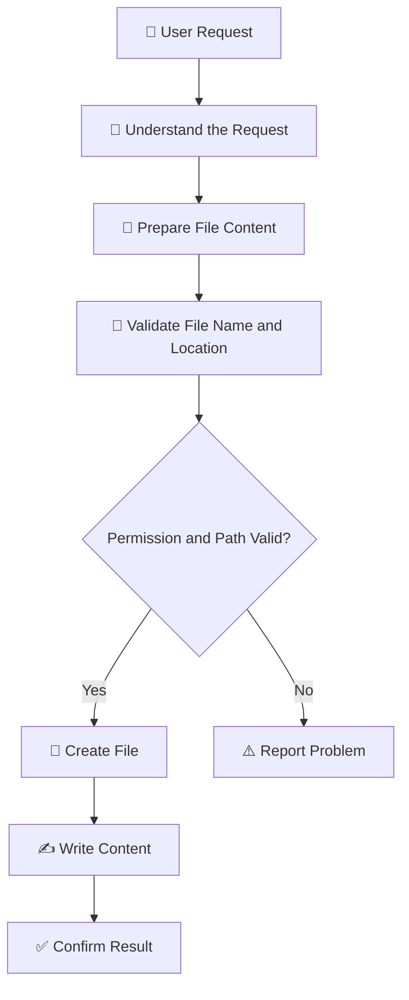

# V3 — File Creation Agent 📝

### Teach an AI agent to create files, write content, and organize information

---

## 1. What Are We Building?

We are building an AI agent that can create files and folders based on a user's instructions.

For example, you can ask:

- Create a text file containing my Java notes.
- Create a folder named `Project Documentation`.
- Generate a Markdown README for my project.
- Create an Excel file containing employee details.
- Create a report and save it in a specified folder.

The agent understands what the user wants, prepares the content, and uses file operations to create the requested output.

**Example:**

You ask, "Create a file named `java_notes.txt` containing the basic concepts of Java."

The agent prepares the content, creates the file in the permitted location, and writes the information into it.

## 2. How Does It Work?

The agent follows these steps:

1. Understands the requested file type and content.
2. Prepares the information to write.
3. Checks the filename and destination.
4. Creates the file or folder.
5. Writes the content.
6. Reports whether the operation succeeded.

## 3. Important Concepts

| Concept | Meaning in Simple English |
|---|---|
| File creation | Creating a new file at a specified location. |
| Directory creation | Creating a new folder. |
| File writing | Saving content into a file. |
| File path | The location where the file should be saved. |
| File extension | The ending that identifies a file type, such as `.txt` or `.md`. |
| Serialization | Converting structured data into a format that can be saved. |
| Templates | Predefined layouts used to create consistently formatted files. |
| Overwriting | Replacing the contents of an existing file. |
| Error handling | Handling problems such as invalid paths or permission errors. |
| Validation | Checking that the requested output is valid and complete. |

## 4. What Types of Files Can We Create?

Different file types require different methods of writing and formatting.

| File Type | Example | Common Use |
|---|---|---|
| Text (`.txt`) | Notes or plain text | Simple information without special formatting. |
| Markdown (`.md`) | GitHub README | Documentation with headings, lists, tables, and links. |
| JSON (`.json`) | Configuration data | Storing structured information. |
| CSV (`.csv`) | Employee records | Storing tabular data in a simple text format. |
| Python (`.py`) | Python script | Saving source code. |
| HTML (`.html`) | Webpage | Creating webpage structure. |
| Word (`.docx`) | Project report | Creating formatted documents. |
| Excel (`.xlsx`) | Expense tracker | Creating worksheets, tables, and calculations. |
| PDF (`.pdf`) | Formal report | Sharing documents in a fixed-layout format. |

Plain-text formats are generally straightforward to create. Formats such as Word, Excel, and PDF often need specialized libraries to handle their structure and formatting correctly.

## 5. Different Approaches to File Creation

There are several ways to create files. Each approach is useful for a different situation.

| Approach | How It Works | When Should We Choose It? | Limitations |
|---|---|---|---|
| **Python file operations** | Uses Python to create files, folders, and write text. | When creating simple text files or learning the fundamentals. | Does not automatically provide advanced document formatting. |
| **Templates** | Fills a predefined structure with new information. | When reports or documents must follow a consistent format. | Less flexible when the requested layout changes significantly. |
| **AI-generated content** | Uses an AI model to prepare content, then saves it to a file. | When users describe what they want in natural language. | Generated content may contain errors and should be checked. |
| **Document-generation libraries** | Uses specialized libraries to create structured files. | When generating formatted Word documents, Excel workbooks, or PDFs. | Different formats require different libraries. |
| **Structured-data serialization** | Converts data into formats such as JSON or CSV. | When storing application data or transferring information between systems. | Requires the data to follow the expected structure. |
| **AI tool calling** | Allows an AI model to request file-creation functions. | When the agent should decide which file operation is appropriate for a request. | The application must validate the requested operation before executing it. |

These approaches can work together. For example, an AI model can generate report content, a template can provide the layout, and a document-generation library can create the final file.

## 6. What Are Templates?

A template is a predefined structure that can be reused to create similar files.

For example, a project report template might contain:

- Project Title
- Introduction
- Objectives
- Technologies Used
- Implementation Details
- Conclusion

Whenever the agent creates a report, it fills these sections with the relevant information.

Templates are useful when consistency matters, such as generating invoices, reports, meeting notes, or project documentation.

## 7. How Can We Create Different File Formats?

| Format | Common Python Option | What It Helps With |
|---|---|---|
| TXT and Markdown | Built-in file operations | Writing plain text and documentation. |
| JSON | `json` module | Saving and loading structured data. |
| CSV | `csv` module | Reading and writing tabular data. |
| Word | `python-docx` | Creating paragraphs, headings, and tables in Word documents. |
| Excel | `openpyxl` | Creating worksheets, cells, and spreadsheet formatting. |
| PDF | `reportlab` | Generating PDF documents and layouts. |

These are examples of tools, not the only possible choices. The best option depends on the required output and formatting.

## 8. What Can Go Wrong?

| Problem | Example | How Should the Agent Respond? |
|---|---|---|
| Invalid filename | The filename contains unsupported characters. | Validate the name and explain the problem. |
| Invalid destination | The requested folder does not exist. | Report the issue or create the folder if authorized. |
| Permission denied | The application cannot write to the destination. | Explain the permission problem. |
| Existing file | A file with the same name already exists. | Ask before replacing it, or use a new filename. |
| Invalid data | The supplied information does not match the expected format. | Validate the data and report the problem. |
| Incomplete output | A report is missing required sections. | Check the output before confirming completion. |
| Unsupported format | The application cannot generate the requested file type. | Explain the limitation or use a suitable supported method. |

## 9. File Creation and Safety

Creating files changes the contents of a computer, so the agent should operate carefully.

Important safety practices include:

- Save files only in permitted locations.
- Validate filenames and destination paths.
- Avoid writing outside the allowed directory.
- Never overwrite an existing file without appropriate confirmation or an explicit safe policy.
- Do not store API keys, passwords, or sensitive information in generated files unnecessarily.
- Validate generated code before anyone runs it.
- Confirm that the file was actually created before reporting success.

**Creating a file and executing its contents are different actions.** This version focuses on creating and saving files, not running generated code.

## 10. File Reading vs. File Creation

| File Reading — V2 | File Creation — V3 |
|---|---|
| Locates existing files. | Creates new files and folders. |
| Reads information from files. | Writes information into files. |
| Extracts and processes existing content. | Generates or formats new content. |
| Example: Read a Java notes file. | Example: Create a new Java notes file. |

The two capabilities can later be combined into one agent that reads existing information and generates a new document from it.

## 11. Final Understanding

A file-creation agent converts a user's request into a saved file or folder.

The basic process is:

**User request → Prepare content → Validate destination → Create file → Write content → Confirm result**

