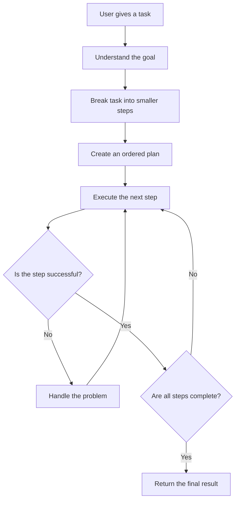

# V4 — Planning Agent

## 1. What Is a Planning Agent?

A Planning Agent takes a big task, breaks it into smaller steps, and decides the order in which those steps should happen.

Instead of trying to complete everything at once, it creates a plan and works through it step by step.

**Example**

User request: *“Research Agentic AI and create a summary report.”*

The agent might create this plan:

1. Search for information about Agentic AI.
2. Read the collected information.
3. Identify the important points.
4. Write a summary.
5. Review the summary and return the final report.

The important idea is that the agent **plans the work before executing it**.

## 2. How Does It Work?

A planning agent does not necessarily need to execute every step itself. It can use tools or delegate work to other agents.

## 3. Important Concepts

### Task decomposition

Breaking a large task into smaller, manageable tasks.

For example, building a website can be divided into designing the page, writing the code, testing it, and fixing errors.

### Planning

Deciding which steps are needed and the order in which they should happen.

### Dependencies

Some steps depend on earlier steps.

For example, you must collect research before writing a research-based report.

### Execution

Carrying out the planned steps using available tools, functions, or other agents.

### Replanning

Changing the plan when something fails or new information becomes available.

For example, if one information source is unavailable, the agent can choose another source.

### State tracking

Keeping track of completed steps, pending steps, and errors so the agent knows where it is in the task.

## 4. Different Ways to Create Plans

| Approach | How it works | When should we choose it and why? |
|---|---|---|
| Rule-based planning | Uses predefined steps and conditions. | Choose it when the task is predictable and the process rarely changes. |
| LLM-based planning | An LLM generates a plan from the user's request. | Choose it when tasks vary and require flexible reasoning. |
| Plan-and-execute | Creates a plan first, then executes each step. | Choose it when the task has several clear stages. |
| Dynamic planning | Updates the plan when circumstances change. | Choose it when failures or new information can change the next action. |
| Human-guided planning | A person reviews or approves the plan. | Choose it when mistakes could be expensive or risky. |

These approaches can also be combined. For example, an LLM can create a plan while ordinary Python code checks that each step is valid.

## 5. Planning Agent vs. Other Agent Concepts

| Concept | Main responsibility |
|---|---|
| Basic LLM Agent (V1) | Answers a request using an LLM. |
| File Reading Agent (V2) | Finds and reads files. |
| File Creation Agent (V3) | Creates files and writes content. |
| Planning Agent (V4) | Decides the steps required to complete a task. |
| Routing Agent (V10) | Chooses which tool, model, or workflow should handle a request. |
| Multi-Agent System (V11) | Coordinates multiple specialized agents. |

A planning agent can use file-reading and file-creation tools. It can also route tasks or delegate steps to other agents.

## 6. Frameworks and Approaches

You do not need a framework for every planning agent. The best choice depends on how complicated the workflow is.

| Option | What it provides | When should we choose it and why? | Cost |
|---|---|---|---|
| Custom Python | Your own planning and execution logic. | Best for learning the fundamentals and building simple planners. | Python is free. LLM usage may cost money. |
| LangChain | Components for building LLM applications and agents. | Useful when you want reusable integrations with models and tools. | Open source; model and hosted-service costs may apply. |
| LangGraph | Explicit control over stateful workflows, decisions, loops, and recovery. | Useful when a plan needs checkpoints, branching, retries, or human approval. | Open source; model and hosted-service costs may apply. |
| Workflow engines | Structured execution of predefined tasks. | Useful when reliability, scheduling, and process tracking matter more than flexible reasoning. | Depends on the particular engine and service. |

**A useful distinction:** LangChain helps assemble components; LangGraph helps control how a stateful workflow moves between steps. Neither is mandatory for learning planning.

## 7. Common Problems

- **Bad plans:** The agent may miss important steps or misunderstand the goal.
- **Unnecessary steps:** The plan may be more complicated than the task requires.
- **Failed execution:** A planned action may not work as expected.
- **Outdated plans:** New information may make the original plan unsuitable.
- **Infinite retries:** The agent may repeatedly attempt a failing step.
- **False completion:** The agent may claim the task is complete without checking the result.

A good planning agent validates its steps, tracks progress, limits retries, and verifies the final result.

## 8. Safety and Reliability

Planning does not automatically make an agent safe or correct.

A reliable planning agent should:

- Check whether the plan matches the user's actual request.
- Restrict actions to the permissions it has been given.
- Ask for approval before sensitive or destructive actions.
- Set limits on the number of steps and retries.
- Verify results rather than trusting its own claims.
- Replan when necessary instead of blindly following a failed plan.

For example, an agent can plan how to organize files, but it should not delete or move important files without the required permissions and safeguards.

## 9. How Do We Know If the Plan Is Good?

A good plan should be:

- **Complete:** It covers the important requirements.
- **Logical:** Steps happen in the right order.
- **Efficient:** It avoids unnecessary work.
- **Achievable:** The required tools and information are available.
- **Adaptable:** It can change when something goes wrong.
- **Verifiable:** We can check whether each step succeeded.

The final result matters more than simply generating a plan that looks convincing.

## 10. Final Understanding

The main lesson of V4 is that an agent needs more than the ability to answer questions. For complex tasks, it must decide **what needs to happen, in what order, and what to do when something fails**.

Remember these three ideas:

1. **Plan:** Break the goal into smaller steps.
2. **Execute:** Carry out the steps and track progress.
3. **Adapt:** Handle failures, revise the plan, and verify the result.

That is the foundation of a Planning Agent.
