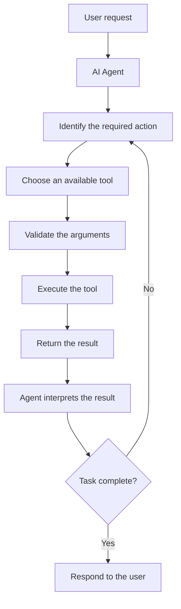

# V5 — Reusable Tool System 🔧

### Organize agent capabilities into reusable, shareable tools

---

## 🎯 The Vision

<div align="center">

```
WITHOUT A TOOL SYSTEM:
┌────────────┐
│ Agent 1    │──→ Read file function
└────────────┘    (Copy-pasted code)

┌────────────┐
│ Agent 2    │──→ Read file function
└────────────┘    (Copy-pasted code)

┌────────────┐
│ Agent 3    │──→ Read file function
└────────────┘    (Copy-pasted code)
             ❌ Messy! Duplicate code everywhere!


WITH A TOOL SYSTEM:
┌────────────────────────────┐
│   REUSABLE TOOL REGISTRY   │
├────────────────────────────┤
│ • read_file()              │
│ • write_file()             │
│ • search_files()           │
│ • list_files()             │
└────────────┬───────────────┘
             │
    ┌────────┼────────┐
    │        │        │
┌───▼──┐ ┌──▼───┐ ┌──▼───┐
│Agent1│ │Agent2│ │Agent3│
└──────┘ └──────┘ └──────┘
         ✅ Clean! No duplication!
```

</div>

---

## 1. What Is a Reusable Tool System?

A Reusable Tool System gives an AI agent a collection of tools it can use to perform different actions.

An LLM can understand requests and generate responses, but it cannot automatically perform every real-world action. Tools give it specific capabilities, such as reading files, searching information, and performing calculations.

Instead of writing separate action logic for every agent, we create reusable tools that different agents can share.

**Example**

Imagine building three agents:

- A File Reading Agent that reads documents.
- A Planning Agent that breaks tasks into steps.
- A Report Agent that creates reports.

All three agents might need a file-reading tool. Instead of implementing that capability three times, we create one reusable tool and let each agent use it when permitted.

## 2. How Does It Work?



### Step-by-Step Flow:

```
1️⃣ Agent analyzes the request
   ↓
2️⃣ Agent decides which tool to use
   ↓
3️⃣ System validates tool inputs
   ↓
4️⃣ Tool executes the action
   ↓
5️⃣ Result returned to agent
   ↓
6️⃣ Agent continues or completes task
```

The agent decides which tool is appropriate, but the tool performs the actual operation.

For example, the LLM can decide that it needs to read a file. A Python function then opens the permitted file and returns its contents.

---

## 3. Important Concepts

| Concept | Meaning | Example |
|---------|---------|---------|
| **Tool** | A specific action an agent can request | `read_file`, `search_files`, `calculate_total` |
| **Tool function** | The actual code that performs the action | Python function that opens and reads a file |
| **Tool registry** | Collection of available tools and descriptions | Central list of all tools with metadata |
| **Tool description** | Clear explanation of what a tool does | "Reads a file from disk and returns contents" |
| **Arguments** | The inputs a tool needs | filename, folder path, search keyword |
| **Tool result** | Information returned after the tool runs | File contents, search results, calculation |
| **Error handling** | Returning clear errors when operation fails | "File not found" instead of silent failure |

---

## 4. Different Ways to Build a Tool System

<div align="center">

| Approach | How it works | When to Choose | Complexity |
|---|---|---|---|
| **Direct Python functions** | Each action is an ordinary function | Learning and small projects | 🟢 Low |
| **Custom tool registry** | Stores tools with names, descriptions, functions | Multiple agents sharing tools | 🟡 Medium |
| **Framework-provided tools** | Standard way to define and connect tools | Larger agent applications | 🟠 Medium-High |
| **MCP Protocol** | Standard connection to external tool servers | Reusable across compatible apps | 🔴 High |
| **Provider-native** | Model provider's supported format | Direct integration with API | 🟡 Medium |

</div>

These options are not mutually exclusive. For example, a Python function can be registered as a framework tool, and an MCP server can expose a tool to compatible clients.

---

## 5. Understanding MCP 🌐

MCP stands for **Model Context Protocol**.

Think of it as a standard connection method between AI applications and external tools or information sources.

```
AI Application A ┐
                 ├──→ MCP Server ──→ [Tool: read_file]
AI Application B ┘                  [Tool: search]
                                     [Tool: calculate]

Result: Different apps use same tools!
```

Without a shared protocol, different applications may need separate integration code for the same service. MCP can make those integrations reusable across compatible clients.

**Important distinction:** MCP provides a communication protocol. It does not automatically make an agent intelligent, guarantee security, or decide whether an action is appropriate.

---

## 6. Tool Calling vs. Tool Execution

These are two different things.

<div align="center">

| | Tool Calling | Tool Execution |
|---|---|---|
| **What** | Model requests a tool | Application runs actual code |
| **Who does it** | AI model | Your application |
| **Example** | Model: "Call delete_file()" | App: Validates, then deletes |
| **Can fail** | Yes (wrong tool choice) | Yes (file doesn't exist) |

</div>

**Key Insight:** A model's request is NOT permission to execute every action.

Example: The model may request `delete_file("report.txt")`. The application must still check:
- ✓ Is deletion allowed?
- ✓ Is approval required?
- ✓ Does the file exist?
- ✓ Is the user authorized?

---

## 7. How Should Tools Be Designed?

A good reusable tool should have:

```
✅ ONE CLEAR PURPOSE
   └─ Each tool performs a specific action
   
✅ CLEAR INPUTS
   └─ Required arguments are defined
   
✅ PREDICTABLE OUTPUTS
   └─ Return results in consistent format
   
✅ ERROR HANDLING
   └─ Report failures clearly
   
✅ PERMISSION CHECKS
   └─ Restrict access to allowed resources
   
✅ USEFUL DESCRIPTIONS
   └─ Explain when and how to use
   
✅ INDEPENDENT TESTING
   └─ Verify tool works without an AI agent
```

For example, instead of building one enormous tool that reads, edits, deletes, and creates files, use separate tools with clearly defined permissions:
- `read_file(path)` - reads only
- `write_file(path, content)` - writes only
- `delete_file(path)` - deletes only

---

## 8. Common Problems ⚠️

<div align="center">

| Problem | Description | Impact |
|---------|-------------|--------|
| **Wrong tool selection** | Agent chooses unsuitable tool | Task fails or wrong result |
| **Invalid arguments** | Model supplies missing/incorrect inputs | Tool crashes or misbehaves |
| **Tool failure** | File, service, or API unavailable | Task incomplete |
| **Duplicate tools** | Multiple tools do same thing | Agent confusion, poor selection |
| **Unclear results** | Tool returns information model can't interpret | Agent doesn't know what to do next |
| **Permission problems** | Tool accesses data it shouldn't | Security vulnerability |
| **Repeated calls** | Agent keeps calling tool without progress | Infinite loop, wasted resources |

</div>

**Solutions:**
- ✅ Clear tool descriptions
- ✅ Input validation
- ✅ Timeouts
- ✅ Sensible retry limits
- ✅ Consistent results

---

## 9. Safety and Permissions 🔒

A reusable tool can be powerful because many agents may have access to it. Its permissions must therefore be carefully controlled.

```
TOOL: read_file()
  Access Level: PUBLIC
  Can access: /allowed/documents/ folder only
  Cannot access: System files, passwords

TOOL: delete_file()
  Access Level: RESTRICTED
  Requires: Human approval
  Logs: All deletion requests
  Cannot access: System files
  
TOOL: send_email()
  Access Level: RESTRICTED
  Requires: Content review
  Limit: 10 emails per hour
  Cannot send: To external addresses
```

**Best Practices:**

- ✅ Give each tool only the access it needs
- ✅ Validate file paths, arguments, external inputs
- ✅ Require approval for destructive/sensitive actions
- ✅ Protect API keys and secrets
- ✅ Set limits on expensive API calls
- ✅ Treat external content as untrusted data
- ✅ Record important actions for audit trails

**Example:** A file-reading tool should not automatically receive permission to delete files. Reading and deleting are different capabilities with separate controls.

---

## 10. Frameworks and Options

| Option | Provides | Choose When | Cost |
|--------|----------|-------------|------|
| **Python** | Functions and program logic | Learning fundamentals | Free & open source |
| **LangChain** | Reusable integrations and tool exposure | Building LLM applications | Open source; external usage may cost |
| **LangGraph** | Stateful workflows with tool calling | Complex tool coordination | Open source; services may cost |
| **OpenAI tools** | Native model interface | Working with OpenAI models | API usage may cost money |
| **MCP** | Standard tool server protocol | Cross-compatible tool sharing | Protocol free; services may cost |

You do not need all these options in one project. Start with Python functions, then introduce a registry when you need to share tools, and consider a framework when your requirements justify it.

---

## 11. The Tool System Journey 🚀

```
V1: Basic Chat
   └─ No tools needed

V2: File Reading
   └─ First tool: read_file()

V3: File Creation
   └─ Add tool: write_file()

V4: Planning
   └─ Organize existing tools

V5: Tool System ← YOU ARE HERE
   └─ Formalize and reuse tools

V6+: Advanced Systems
   └─ Build on solid tool foundation
```

---

## 12. Final Understanding

The main lesson of V5 is that an agent should not need a completely new implementation every time it needs to perform an action.

Remember these five ideas:

1. **Create tools:** Give each tool one clear responsibility.
2. **Reuse tools:** Allow different agents to share approved capabilities.
3. **Choose tools:** Let the agent request the tool that fits the task.
4. **Validate execution:** Check inputs, permissions, and results.
5. **Control access:** Make sure tools can perform only the actions they are allowed to perform.

A reusable tool system is one of the foundations of a more capable agentic AI application.

---

<div align="center">

## 🎓 Key Takeaway

```
Without Tool System:
  ❌ Code duplication
  ❌ Hard to maintain
  ❌ Security gaps
  ❌ Inconsistent behavior

With Tool System:
  ✅ Single source of truth
  ✅ Easy to maintain
  ✅ Centralized permissions
  ✅ Consistent behavior
```

</div>
