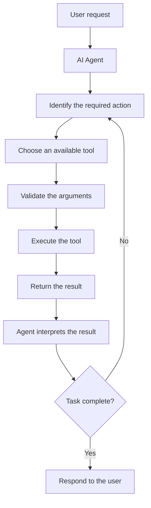

# V5 — Reusable Tool System

## 1. What Is a Reusable Tool System?

A Reusable Tool System gives an AI agent a collection of tools it can use to perform different actions.

An LLM can understand requests and generate responses, but it cannot automatically perform every real-world action. Tools give it specific capabilities, such as reading files, searching information, calculating values, or creating documents.

Instead of writing separate action logic for every agent, we create reusable tools that different agents can share.

**Example**

Imagine building three agents:

- A File Reading Agent that reads documents.
- A Planning Agent that breaks tasks into steps.
- A Report Agent that creates reports.

All three agents might need a file-reading tool. Instead of implementing that capability three times, we create one reusable tool and let each agent use it when permitted.

## 2. How Does It Work?

The agent decides which tool is appropriate, but the tool performs the actual operation.

For example, the LLM can decide that it needs to read a file. A Python function then opens the permitted file and returns its contents.

## 3. Important Concepts

### Tool

A tool is a specific action an agent can request.

Examples include `read_file`, `search_files`, `calculate_total`, and `create_report`.

### Tool function

The actual code that performs the action.

For example, a Python function can receive a filename, read the file, and return its contents.

### Tool registry

A collection of available tools and their descriptions.

The registry helps an agent or framework identify which tools exist and what they do.

### Tool description

A clear explanation of what a tool does, when to use it, and what information it requires.

Good descriptions help the model select the correct tool.

### Arguments

The inputs a tool needs to perform its action.

For example, a `search_files` tool might accept a folder path and a search keyword.

### Tool result

The information returned after the tool runs. The agent uses this result to decide what to do next.

### Error handling

Tools should return understandable errors when an operation fails, rather than pretending it succeeded.

## 4. Different Ways to Build a Tool System

| Approach | How it works | When should we choose it and why? |
|---|---|---|
| Direct Python functions | Each action is an ordinary function. | Best for learning and small projects with a few tools. |
| Custom tool registry | Stores reusable tools with names, descriptions, and execution functions. | Choose it when several agents need to share tools. |
| Framework-provided tools | A framework provides a standard way to define and connect tools to agents. | Choose it when building a larger agent application with many integrations. |
| MCP (Model Context Protocol) | Provides a standard way for compatible AI applications to connect to external tools and data sources through MCP servers. | Choose it when you want compatible applications to reuse tool integrations across projects. |
| Provider-native tool calling | Uses a model provider's supported format for requesting tool execution. | Choose it when integrating directly with a specific model provider. |

These options are not mutually exclusive. For example, a Python function can be registered as a framework tool, and an MCP server can expose a tool to compatible clients.

## 5. Understanding MCP

MCP stands for **Model Context Protocol**.

Think of it as a standard connection method between AI applications and external tools or information sources.

Without a shared protocol, different applications may need separate integration code for the same service. MCP can make those integrations reusable across compatible clients.

For example:

- An MCP server exposes a file-search tool.
- An MCP-compatible AI application connects to that server.
- The application can discover and request the tool, subject to its permissions.

**Important distinction:** MCP provides a communication protocol. It does not automatically make an agent intelligent, guarantee security, or decide whether an action is appropriate.

## 6. Tool Calling vs. Tool Execution

These are two different things.

| Tool calling | Tool execution |
|---|---|
| The model requests a particular tool. | The application runs the actual code. |
| The model supplies arguments in the expected format. | The application validates those arguments and performs the action. |
| The model may choose the wrong tool or provide invalid inputs. | The code can reject invalid inputs and return an error. |

For example, the model may request `delete_file("report.txt")`. The application must still check whether deletion is allowed and whether approval is required.

A model's request is not permission to execute every action.

## 7. How Should Tools Be Designed?

A good reusable tool should have:

- **One clear purpose:** Each tool should perform a specific action.
- **Clear inputs:** Required arguments should be defined.
- **Predictable outputs:** Return results in a consistent format.
- **Error handling:** Report failures clearly.
- **Permission checks:** Restrict access to allowed resources.
- **Useful descriptions:** Explain when and how the tool should be used.
- **Independent testing:** Verify that the tool works even without an AI agent.

For example, instead of building one enormous tool that reads, edits, deletes, and creates files, use separate tools with clearly defined permissions.

## 8. Common Problems

- **Wrong tool selection:** The agent chooses an unsuitable tool.
- **Invalid arguments:** The model supplies missing or incorrectly formatted inputs.
- **Tool failure:** A file, service, or API is unavailable.
- **Duplicate tools:** Several tools perform almost the same action, confusing selection.
- **Unclear results:** The tool returns information the model cannot interpret properly.
- **Permission problems:** A tool accesses information or performs actions it should not.
- **Repeated calls:** The agent keeps calling a tool without making progress.

Clear tool descriptions, input validation, timeouts, sensible retry limits, and consistent results help address these problems.

## 9. Safety and Permissions

A reusable tool can be powerful because many agents may have access to it. Its permissions must therefore be carefully controlled.

- Give each tool only the access it needs.
- Validate file paths, arguments, and external inputs.
- Require approval for destructive or sensitive actions.
- Protect API keys and other secrets.
- Set limits on expensive API calls and repeated execution.
- Treat content returned by websites and documents as untrusted data.
- Record important actions when an audit trail is needed.

For example, a file-reading tool should not automatically receive permission to delete files. Reading and deleting are different capabilities and should have separate controls.

## 10. Frameworks and Options

| Option | What it provides | When should we choose it and why? | Cost |
|---|---|---|---|
| Python | Functions and ordinary program logic. | Best for understanding how tools work internally. | Free and open source. |
| LangChain | Reusable integrations and ways to expose functions as tools to models. | Useful when building LLM applications with multiple tools. | Open source; external model or service usage may cost money. |
| LangGraph | Stateful workflows that can call tools, branch, retry, and pause for approval. | Useful when tool usage needs explicit control over workflow and recovery. | Open source; external model or service usage may cost money. |
| OpenAI tool calling | A supported interface for models to request functions or other tools. | Useful when working with compatible OpenAI models and APIs. | API usage may cost money; check current pricing. |
| MCP | A protocol for connecting compatible applications to external tool servers. | Useful when tool integrations should be reusable across compatible clients. | The protocol is open; individual services may have costs. |

You do not need all these options in one project. Start with Python functions, then introduce a registry when you need to share tools, and consider a framework or MCP when your requirements justify it.

## 11. Final Understanding

The main lesson of V5 is that an agent should not need a completely new implementation every time it needs to perform an action.

Remember these ideas:

1. **Create tools:** Give each tool one clear responsibility.
2. **Reuse tools:** Allow different agents to share approved capabilities.
3. **Choose tools:** Let the agent request the tool that fits the task.
4. **Validate execution:** Check inputs, permissions, and results.
5. **Control access:** Make sure tools can perform only the actions they are allowed to perform.

A reusable tool system is one of the foundations of a more capable agentic AI application.