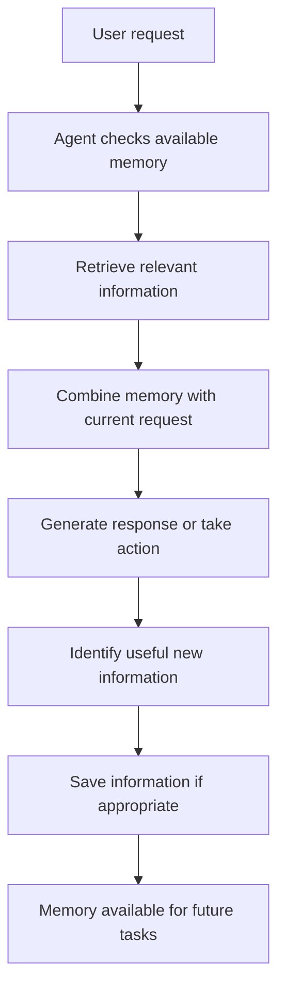

# V6 — Agent Memory

## 1. What Is Agent Memory?

Agent Memory allows an AI agent to retain useful information so it does not have to start from zero every time.

Without memory, an agent may forget earlier instructions, previous results, or information the user shared in an earlier session.

With memory, the agent can use relevant information from previous steps or conversations to make better decisions.

**Example**

Imagine asking an agent:

- Day 1: “I'm building a Python project. I prefer simple explanations.”
- Day 2: “Explain how to add a new feature.”

An agent with suitable saved memory may remember your project context and preference for simple explanations.

Memory is useful when the agent needs information beyond the current request.

## 2. How Does It Work?

Not every agent needs to save every conversation. A good memory system stores useful information and retrieves only what is relevant.

## 3. Types of Agent Memory

### Short-term memory

Information needed during the current task or conversation.

**Example:** The agent remembers that you asked it to create a report and that the report must contain three sections.

Short-term memory may exist only while the task is running, or it may be stored for the duration of a conversation.

### Long-term memory

Information saved for use in future tasks or sessions.

**Example:** The agent remembers a user's preferred report format across separate sessions.

Long-term memory requires some form of persistence, such as a file or database, if the information must survive an application restart.

### Episodic memory

A record of specific past events or interactions.

**Example:** The agent records that a previous report-generation attempt failed because the source file was missing.

### Semantic memory

General facts or knowledge stored for later use.

**Example:** The agent remembers that a particular project uses Python and stores its configuration in a JSON file.

### Working memory

Information the agent needs to reason about and complete its current task.

**Example:** While solving a problem, the agent keeps track of the current plan, completed steps, and remaining work.

Working memory is often part of the agent's current state. It is not necessarily permanent storage.

## 4. Different Ways to Store Memory

| Storage method | How it works | When should we choose it and why? |
|---|---|---|
| In-memory variables | Stores information while the program is running. | Best for temporary information and simple experiments. |
| JSON or text files | Saves information in readable files. | Good for small projects where memory is simple and easy to inspect. |
| SQLite | Stores structured information in a local database. | Useful when memory needs searching, updating, and reliable persistence without a separate database server. |
| Traditional database | Stores structured records in a database service. | Useful for larger applications, multiple users, and more complex data requirements. |
| Vector database | Finds information by semantic similarity rather than only exact words. | Useful when an agent must retrieve relevant information from large collections of text. |

These methods solve different problems. A vector database is not automatically better than a regular database; the right choice depends on how the agent needs to search its memories.

## 5. How Does Memory Retrieval Work?

Saving information is only half the job. The agent also needs to find the right information when it is needed.

Common retrieval methods include:

| Method | How it works | When should we choose it and why? |
|---|---|---|
| Exact lookup | Searches for a specific key or identifier. | Best when the information is stored under a known name. |
| Keyword search | Finds records containing particular words. | Useful when users remember the words used in a previous interaction. |
| Metadata filtering | Filters records by details such as date, user, or project. | Useful when memory needs to be restricted to a specific context. |
| Semantic search | Finds information with a similar meaning, even when the wording differs. | Useful when users ask questions in different words from those used in the saved information. |
| Hybrid search | Combines keyword matching and semantic search. | Useful when both exact terms and meaning are important. |

For example, if the memory contains “The project uses Python,” semantic search may find it when the user asks, “Which programming language am I using?”

## 6. Embeddings and Vector Memory

Embeddings represent text as numerical values that capture aspects of its meaning.

A vector search system compares these numerical representations to find text that is semantically similar to a query.

A typical process looks like this:

1. Split information into manageable pieces.
2. Convert those pieces into embeddings.
3. Store the embeddings with the associated text and metadata.
4. Convert a new query into an embedding.
5. Retrieve relevant pieces using similarity search.
6. Give the retrieved information to the agent as context.

This is useful for searching large amounts of conversation history, notes, or documents.

**Important:** Similarity does not guarantee correctness. The agent should still check whether retrieved information is relevant, current, and appropriate to use.

## 7. Memory vs. RAG vs. Conversation History

These concepts are related, but they are not identical.

| Concept | Main purpose | Example |
|---|---|---|
| Conversation history | Keeps track of messages in a conversation. | Remembering what was said earlier in the current chat. |
| Agent memory | Selectively stores and retrieves useful information for future actions. | Remembering a user's preferences or previous task outcomes. |
| RAG | Retrieves relevant information from an external knowledge source to help answer a question. | Searching project documentation before answering a technical question. |

An agent memory system can use RAG-style retrieval. For example, it can search saved memories and provide the relevant results to the model. However, not every memory system needs embeddings or a vector database.

## 8. Common Memory Approaches and Frameworks

| Option | What it provides | When should we choose it and why? | Cost |
|---|---|---|---|
| Custom Python memory | Your own logic for saving, searching, and retrieving information. | Best for learning how memory works and keeping the design simple. | Python is free; external model usage may cost money. |
| File-based memory | Saves information in files such as JSON. | Good for small projects and easy manual inspection. | Usually free. |
| SQLite | Persistent local structured storage. | Good for projects that need organized records and searchable history. | Free and open source. |
| LangGraph persistence | Saves workflow state and supports resuming workflows, depending on the configured checkpointer. | Useful when an agent must continue a workflow or preserve state between steps. | Open source; hosting or external service costs may apply. |
| Vector databases | Store and retrieve information using vector similarity. | Useful when memory contains many text records and semantic retrieval is needed. | Many open-source options are available; hosted services may charge. |

A saved workflow state is not automatically the same as long-term user memory. For example, restoring a workflow's current step does not necessarily mean the agent has learned a user's preferences.

## 9. Common Problems

- **Too much memory:** Saving everything makes retrieval noisy and unnecessary.
- **Irrelevant retrieval:** The agent may retrieve information that does not apply to the current request.
- **Outdated information:** Old facts may no longer be true.
- **Contradictory memories:** Different records may contain conflicting information.
- **Duplicate records:** The same information may be saved repeatedly.
- **Privacy concerns:** Saved conversations may contain sensitive information.
- **False memories:** The system may save an incorrect interpretation as if it were a fact.

A reliable memory system should support updating and deleting records, identify information that may be outdated, and avoid treating uncertain information as a confirmed fact.

## 10. Safety and Privacy

Memory can make agents more useful, but it also creates responsibility.

- Save only information that is useful and appropriate to retain.
- Avoid storing passwords, API keys, and unnecessary sensitive information.
- Separate users' memories so one user cannot access another user's information.
- Allow users to review or delete saved information when appropriate.
- Treat retrieved content as data, not as instructions that automatically override system rules.
- Apply access controls to stored information.
- Consider retention periods and how backups are handled.

Memory should improve the agent's ability to help without collecting more information than it needs.

## 11. How Do We Evaluate Memory?

A good memory system should be assessed on:

- **Retrieval accuracy:** Does it find the right information?
- **Relevance:** Does the retrieved information help with the current task?
- **Freshness:** Does it use updated information when facts change?
- **Consistency:** Does it handle conflicting records sensibly?
- **Efficiency:** Does retrieval use reasonable time and resources?
- **Privacy:** Is information stored and accessed appropriately?
- **Task improvement:** Does memory actually improve the final result?

A system that stores a large amount of information is not necessarily a good memory system. What matters is whether it retrieves the right information at the right time.

## 12. Final Understanding

The main lesson of V6 is that an agent can become more useful when it can retain and retrieve relevant information instead of repeatedly starting from scratch.

Remember these five ideas:

1. **Store:** Save useful information when appropriate.
2. **Retrieve:** Find the information relevant to the current task.
3. **Update:** Correct or remove outdated information.
4. **Use:** Combine retrieved memory with the current request.
5. **Protect:** Keep saved information secure and respect privacy.

Memory does not guarantee that an agent will learn or remember everything correctly. It is a system for storing and retrieving information that helps the agent work more effectively.