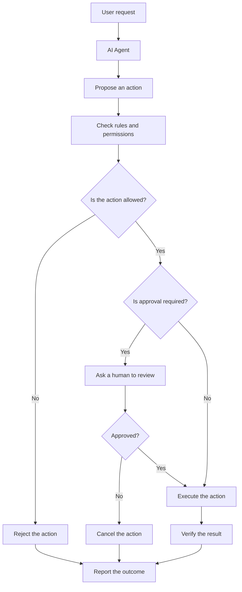

# V7 — Safety & Human Approval

## 1. What Is Safety & Human Approval?

An AI agent can do more than answer questions. It may read files, create documents, call APIs, modify data, or trigger actions.

But what happens if the agent misunderstands a request or chooses the wrong action?

Safety controls define what the agent is allowed to do. Human approval ensures that a person can review important actions before they happen.

**Example**

Imagine building an agent that organizes files on your computer.

- Reading filenames: allowed automatically.
- Creating a new folder: allowed within a permitted location.
- Moving files: may require confirmation.
- Permanently deleting files: requires explicit approval.

The goal is to make the agent useful without giving it unlimited freedom.

## 2. How Does It Work?

The agent may suggest an action, but the safety layer determines whether it is permitted. If approval is required, execution must wait until approval is received.

## 3. Important Concepts

### Permissions

Permissions define which actions the agent can perform and which resources it can access.

For example, an agent may read files in a selected folder but have no permission to access the rest of the computer.

### Safety rules

Rules describe actions that are allowed, restricted, or prohibited.

For example, an agent may create reports automatically but must not send emails to customers without authorization.

### Human-in-the-loop (HITL)

Human-in-the-loop means a person participates in an agent's workflow.

A person may approve an action, correct a decision, provide missing information, or reject a proposed operation.

### Action validation

Before executing an action, the system checks whether its inputs and intended effects meet the required rules.

### Least privilege

Give an agent only the minimum permissions needed to complete its task.

For example, an agent that only reads documents should not receive permission to delete them.

### Audit logs

Audit logs record important events, such as which action was requested, whether it was approved, and whether it succeeded.

Logs should avoid unnecessarily storing passwords, API keys, or other sensitive information.

## 4. Different Safety Approaches

| Approach | How it works | When should we choose it and why? |
|---|---|---|
| Rule-based validation | Checks actions against predefined rules. | Best for clear, predictable restrictions. |
| Permission controls | Limits which files, services, and operations an agent can access. | Essential when agents interact with real systems or private data. |
| Human approval | Pauses for a person to approve a sensitive action. | Useful for irreversible, costly, or externally visible actions. |
| Sandboxing | Runs operations inside a restricted environment. | Useful when testing untrusted code or limiting the effects of failures. |
| Rate and resource limits | Restricts repeated calls, spending, or resource consumption. | Useful for preventing runaway loops and unexpected costs. |
| Audit logging | Records important actions and decisions. | Useful for debugging, accountability, and investigating incidents. |

These approaches complement one another. Human approval alone is not enough if the agent can bypass the approval mechanism.

## 5. When Should an Agent Ask for Approval?

Not every action needs human approval. Asking too often makes an agent slow and frustrating to use.

| Action | Suggested control | Why? |
|---|---|---|
| Read an allowed public document | Automatic | Usually low risk. |
| Summarize a local document | Automatic, if access is authorized | The action does not normally change the source document. |
| Create a file in an approved folder | Automatic or configurable | The action is generally reversible. |
| Overwrite an existing file | Ask first | Existing information could be lost. |
| Move many files | Ask first or use a preview | A mistake could disrupt the user's organization. |
| Permanently delete files | Require explicit approval | The action may be difficult or impossible to reverse. |
| Send an external email | Require approval when appropriate | The action affects another person and cannot reliably be undone. |
| Make a purchase or financial transaction | Require strong authorization | The action can create a financial obligation. |

The correct policy depends on the consequences of an action, the user's authorization, and whether the action can be reversed.

## 6. Different Ways to Implement Human Approval

| Method | How it works | When should we choose it and why? |
|---|---|---|
| Command-line confirmation | The agent asks the user to confirm in the terminal. | Good for small projects and learning. |
| Web or desktop approval screen | The user reviews an action through a user interface. | Useful when building an application for everyday users. |
| Approval workflow | The task pauses until an authorized person approves or rejects it. | Useful for business processes involving multiple steps. |
| Framework-supported interruption | The agent workflow pauses and resumes after a human decision. | Useful when the agent must preserve its state while waiting. |
| Role-based approval | Only people with specific roles can approve certain actions. | Useful for business systems with different permission levels. |

An approval request should clearly explain what the agent wants to do, which resources are affected, and what will happen if the action proceeds.

## 7. Frameworks and Safety Options

| Option | What it provides | When should we choose it and why? | Cost |
|---|---|---|---|
| Custom Python rules | Your own validation and permission checks. | Best for learning and simple, controlled workflows. | Python is free. |
| LangGraph | Supports pausing workflows, human review, and resuming execution when configured appropriately. | Useful when approval is part of a multi-step agent workflow. | Open source; hosting and model usage may cost money. |
| OpenAI Agents SDK | Provides agent orchestration features, including configurable human approval for supported tool operations. | Useful when building agents with supported OpenAI integrations. | SDK is open source; API usage may cost money. |
| Operating-system permissions and sandboxing | Restricts access to files, processes, and other resources. | Useful when limiting what an agent can do on a machine. | Depends on the operating system and tools used. |
| Policy engines | Evaluate actions against centralized authorization rules. | Useful for larger applications with many tools and detailed access policies. | Depends on the specific implementation. |

A framework can help implement safety controls, but it does not automatically make the entire application safe. The application's permissions, tool implementations, and deployment environment still matter.

## 8. Common Safety Risks

### Prompt injection

A document or webpage may contain text that tries to manipulate the agent into ignoring its intended instructions.

**Protection:** Treat external content as untrusted data, enforce permissions outside the model, and require approval for sensitive operations.

### Unauthorized actions

The agent may attempt to access a file or service it should not use.

**Protection:** Validate permissions at the execution layer, not just in the agent's prompt.

### Accidental deletion or modification

The agent may misunderstand which files should be changed.

**Protection:** Preview changes, create backups where appropriate, and require confirmation for destructive actions.

### Infinite loops and unexpected costs

An agent may repeatedly call tools or services without making progress.

**Protection:** Set limits on retries, execution time, tool calls, and spending.

### False approval

A system may accidentally treat an old approval as permission for a different action.

**Protection:** Bind approval to the specific action, its parameters, and the resources affected. Recheck authorization before execution.

### Sensitive data exposure

An agent may send private information to an external service or include it in logs.

**Protection:** Limit access, minimize stored data, and validate what information leaves the system.

## 9. Safety vs. Reliability

Safety and reliability are related, but they are not the same.

| Safety | Reliability |
|---|---|
| Prevents unauthorized or harmful actions. | Helps actions work correctly and consistently. |
| Checks whether an action is permitted. | Checks whether an action succeeds as intended. |
| Example: Prevents deletion without approval. | Example: Detects that a file was not created successfully. |

A good agent needs both. An action can be permitted but still fail, and an action can succeed technically while being unauthorized.

## 10. How Do We Evaluate Safety?

Test the agent with realistic situations:

- Does it reject actions outside its permissions?
- Does it request approval when required?
- Does it wait for approval before executing the action?
- Does rejecting an action actually prevent execution?
- Can untrusted document content bypass the safety rules?
- Does the system stop when retry or resource limits are reached?
- Can authorized users review important actions?
- Does it report success only after verifying the result?

Test both normal tasks and deliberately problematic requests. A safety mechanism that works only when the agent behaves correctly is not sufficient.

## 11. Final Understanding

The main lesson of V7 is that an agent should not have unlimited freedom just because it can perform actions.

Remember these five ideas:

1. **Restrict:** Give the agent only the permissions it needs.
2. **Validate:** Check every important action before execution.
3. **Approve:** Involve a human when the action requires authorization.
4. **Monitor:** Track important operations and enforce limits.
5. **Verify:** Confirm the actual result instead of trusting the agent's claim.

**The key principle:** The AI may recommend an action, but the application must enforce what the AI is allowed to do.