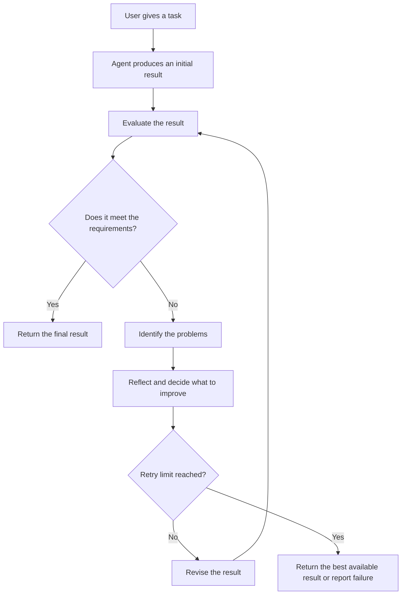

# V8 — Reflection & Evaluation

## 1. What Is Reflection & Evaluation?

An AI agent can produce an answer or complete an action, but how does it know whether the result is actually good?

**Reflection** allows an agent to review its own work, identify possible mistakes, and decide whether it should improve the result.

**Evaluation** checks the quality of the result against specific requirements or criteria.

**Example**

Imagine asking an agent to create a report about Agentic AI.

1. The agent writes the report.
2. It checks whether all requested topics are included.
3. It identifies missing information.
4. It revises the report.
5. It checks the final result before returning it.

The goal is not simply to make the agent try again. It is to help the agent produce a result that meets the requirements.

## 2. How Does It Work?

The evaluation criteria should be defined before the agent starts when possible. Otherwise, the agent may judge its work using unclear or changing standards.

## 3. Important Concepts

### Reflection

Reviewing previous work to identify mistakes, missing information, or possible improvements.

**Example:** The agent notices that its report does not include the limitations requested by the user.

### Evaluation

Measuring whether the result meets defined requirements.

**Example:** Checking whether the report contains all five required sections.

### Feedback

Information about what was incorrect or could be improved.

**Example:** “The answer is missing two required topics.”

### Iteration

Repeating a process to improve a result.

**Example:** Write a report, review it, revise it, and review it again.

### Self-correction

Using feedback to modify an earlier result.

Self-correction is useful only when the agent can make meaningful improvements. Repeating the same action without learning from the feedback wastes time and resources.

### Stopping condition

A rule that determines when the agent should stop reviewing or retrying.

For example, stop when the result passes validation or when the maximum number of attempts is reached.

## 4. Different Ways to Evaluate an Agent

| Approach | How it works | When should we choose it and why? |
|---|---|---|
| Rule-based checks | Checks specific conditions using ordinary code. | Best when requirements are clear and objectively measurable. |
| Unit tests | Tests whether individual functions behave correctly. | Best for checking tools and code-based operations. |
| LLM-as-a-judge | Uses another LLM call to assess a response against a rubric. | Useful for evaluating qualities such as clarity, relevance, and completeness. |
| Human evaluation | A person reviews the result. | Useful when expert judgment or high confidence is required. |
| Reference-based evaluation | Compares the result with a trusted answer or reference. | Useful when expected answers are available. |
| Outcome-based evaluation | Checks whether the task was actually completed successfully. | Essential when the agent performs actions rather than only generating text. |

These methods can be combined. For example, a report-writing agent can use code to check required headings and an LLM to review clarity.

## 5. Reflection vs. Evaluation

They are related, but they have different purposes.

| Reflection | Evaluation |
|---|---|
| Examines the work and considers improvements. | Judges the result against criteria. |
| May suggest why something went wrong. | Produces a score, pass/fail result, or structured feedback. |
| Often helps guide the next attempt. | Helps determine whether another attempt is needed. |
| Example: “The explanation is too complicated.” | Example: “The readability requirement was not met.” |

A reflection step can use evaluation feedback to decide what to improve.

## 6. Different Reflection Patterns

### Single review

The agent produces a result and reviews it once.

**Choose this when:** The task is simple and one review is likely to be sufficient.

### Generate, critique, and revise

One step creates the result, another reviews it, and the agent revises it based on the feedback.

**Choose this when:** Writing quality, completeness, or reasoning needs improvement.

### Iterative improvement

The agent repeats evaluation and revision until it meets the criteria or reaches a limit.

**Choose this when:** Several rounds of improvement may be useful.

### Independent verification

A separate checker validates the result rather than relying entirely on the agent that produced it.

**Choose this when:** Errors matter and independent checks can catch mistakes that self-review misses.

### Test-driven evaluation

The system runs predefined tests to determine whether the result behaves correctly.

**Choose this when:** The agent creates code, processes data, or performs operations with measurable outcomes.

## 7. Frameworks and Tools

| Option | What it provides | When should we choose it and why? | Cost |
|---|---|---|---|
| Custom Python checks | Rules, comparisons, and retry logic. | Best for learning and objective checks. | Python is free. |
| Pytest | A framework for automated Python testing. | Useful when evaluating code and reusable functions. | Free and open source. |
| LLM-as-a-judge | A model evaluates outputs against a defined rubric. | Useful when quality is difficult to measure using ordinary rules alone. | Depends on the model; API usage may cost money. |
| LangGraph | Supports evaluation loops, conditional branching, and controlled retries. | Useful when reflection is one stage of a larger agent workflow. | Open source; external service usage may cost money. |
| LangSmith | Tools for tracing, testing, and evaluating LLM applications. | Useful when you need to inspect agent runs and compare results systematically. | Availability and pricing depend on the plan and usage. |
| Human review | A person checks the output or proposed action. | Useful for important decisions and cases requiring expertise. | Depends on the review process. |

You do not need all these tools. Begin with simple Python checks and introduce model-based evaluation only when the requirements cannot be checked reliably with ordinary code.

## 8. Common Problems

- **Incorrect self-evaluation:** The agent may approve an answer that contains mistakes.
- **Repeated failures:** The agent may keep producing nearly identical results.
- **Unclear criteria:** The agent may not know what a successful result looks like.
- **Excessive retries:** Too many review cycles increase time and cost.
- **Unnecessary changes:** The agent may damage a good result while trying to improve it.
- **Judge inconsistency:** An LLM evaluator may give different scores to similar answers.
- **False confidence:** A high score does not prove that the answer is factually correct.

To reduce these problems, use clear evaluation criteria, independent checks where possible, bounded retries, and explicit stopping conditions.

## 9. How Do We Design a Good Evaluation System?

A useful evaluation system should:

- Define success before execution.
- Use measurable checks wherever possible.
- Provide specific feedback instead of vague criticism.
- Separate objective checks from subjective judgments.
- Limit retries and avoid endless loops.
- Verify the final result independently when appropriate.
- Record failures so the system can be tested and improved.
- Compare performance before and after adding reflection.

For example, if an agent creates a CSV file, checking that the file exists is not enough. The system should also verify its columns, row count, and required values.

## 10. How Do We Measure Improvement?

Useful measurements include:

| Metric | What it tells us |
|---|---|
| Task success rate | How often the agent completes tasks correctly. |
| Accuracy | How often answers or predictions are correct. |
| Completeness | Whether all required parts are included. |
| Revision success rate | How often a retry fixes the identified problem. |
| Retry count | How many attempts are needed. |
| Latency | How long the task takes. |
| Cost per task | How much each run costs. |
| Regression rate | How often a revision breaks something that previously worked. |

A reflection loop is worthwhile only if it improves the result enough to justify its additional time and cost.

## 11. Safety and Reliability

Reflection does not guarantee correctness. An agent can confidently review its own mistake and repeat it.

For reliable results:

- Do not let the model be the only judge of high-impact actions.
- Use trusted tests or independent verification when possible.
- Never treat a high evaluation score as proof of factual accuracy.
- Keep retries within defined limits.
- Require human approval for sensitive actions when appropriate.
- Preserve the original result when revisions could cause data loss.
- Report uncertainty or failure instead of claiming success without evidence.

**Important:** Reviewing an action after it happens cannot undo its consequences. For risky operations, validate and authorize the action before execution as well.

## 12. Final Understanding

The main lesson of V8 is that producing an answer is not the same as producing a good answer.

Remember these five ideas:

1. **Generate:** Produce an initial result.
2. **Evaluate:** Check it against clear requirements.
3. **Reflect:** Identify what needs improvement.
4. **Revise:** Make targeted changes when useful.
5. **Verify:** Confirm the final result and stop at the right time.

Reflection helps an agent improve its work. Evaluation helps determine whether that improvement is real.