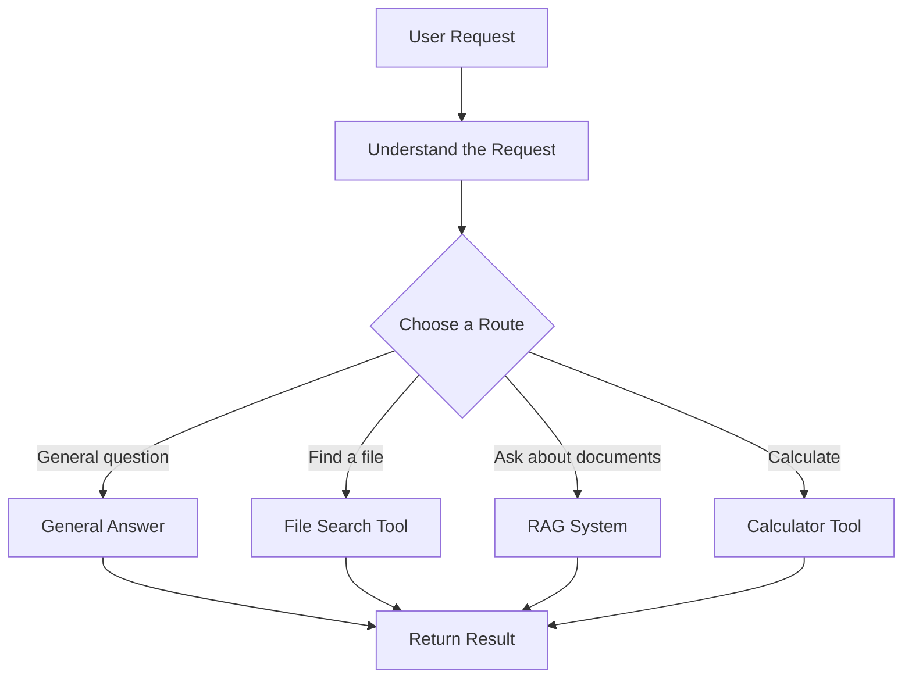

# V10 — Routing Agent 🔀

### An AI agent that decides where a request should go

---

## 1. What Are We Building?

We are building an AI agent that understands a user's request and directs it to the most suitable tool or specialized agent.

Imagine you have one AI application that can perform different tasks:

- Answer general questions.
- Search files.
- Answer questions using documents (RAG).
- Perform calculations.
- Summarize text.

Instead of using the same process for every request, the routing agent decides which path is suitable.

**Example:**

You ask: "Find my Java notes and summarize inheritance."

The routing agent identifies that this request needs file searching and document summarization, then directs it to the appropriate workflow.

The main idea is simple:

**Understand the request → Choose a route → Send it to the right destination.**

## 2. How Does a Routing Agent Work?

The routing agent acts like a receptionist. It receives a request, understands what is needed, and sends it to the correct destination.

## 3. Important Concepts

| Concept | Meaning in Simple English |
|---|---|
| Routing | Sending a request to the correct destination. |
| Intent classification | Identifying what the user wants to do. |
| Router | The component that chooses a route. |
| Destination | The tool, agent, model, or workflow that receives the request. |
| Conditional logic | Choosing a path based on a condition. |
| Fallback | Using an alternative route when the preferred route cannot handle the request. |
| Confidence score | An estimate of how certain a classifier or model is about its choice. |
| Human approval | Asking a person to confirm a decision when necessary. |
| Routing evaluation | Checking whether requests are sent to the correct destinations. |

## 4. Different Routing Methods

Not every routing agent needs an AI model. We can choose from several approaches depending on the problem.

| Method | How It Works | When Should We Choose It? | Limitations |
|---|---|---|---|
| **Rule-Based Routing** | Uses predefined conditions or keywords. | When requests are predictable and rules are easy to define. | Can fail when users phrase requests in unexpected ways. |
| **Keyword Routing** | Looks for specific words or phrases. | When a small set of obvious keywords identifies the task. | A word can have different meanings in different contexts. |
| **Intent Classification** | Classifies a request into categories such as search, summarize, or calculate. | When requests fit a known set of categories. | Requires suitable examples or a capable classifier. |
| **LLM-Based Routing** | Asks a language model to understand the request and choose a destination. | When users express the same intent in many different ways. | Can make incorrect choices and may require an API or local model. |
| **Embedding-Based Routing** | Compares a request's embedding with examples of known task categories. | When semantically similar requests should follow the same route. | Depends on the embedding model and the quality of the examples. |
| **Hybrid Routing** | Combines rules, classification, and model-based decisions. | When some tasks need strict rules while others need language understanding. | More complex to maintain and test. |
| **Confidence-Based Routing** | Uses a confidence or uncertainty measure to decide whether to route automatically or ask for clarification. | When uncertain requests should not be sent blindly to a tool. | Confidence scores may be poorly calibrated and should not be trusted alone. |

## 5. How Does a Router Choose a Destination?

Imagine that a user sends this request:

> "Find my project report and explain its main points."

The router may interpret the request as follows:

| Request Type | Destination |
|---|---|
| General question | General-purpose answer path |
| Search for a file | File-search tool |
| Ask questions about documents | RAG system |
| Perform a calculation | Calculator |
| Unclear request | Ask a clarifying question |
| Restricted or risky action | Safety checks or human approval |

A router does not need to solve the entire task itself. Its main responsibility is to choose the correct next step.

Some requests may need more than one destination. For example, finding a report and summarizing it may require file search followed by a summarization workflow.

## 6. What Happens When Routing Goes Wrong?

A routing agent can misunderstand a request or choose a tool that cannot handle it.

| Problem | Example | Possible Response |
|---|---|---|
| Wrong route | A document question is sent to a general-answer path. | Reclassify or redirect the request. |
| Unknown intent | The request does not fit any known category. | Ask the user to clarify. |
| Tool unavailable | The selected search tool is not working. | Use an approved fallback or explain the issue. |
| Low confidence | The router cannot reliably determine the user's intent. | Ask a question rather than guessing. |
| Multiple possible routes | A request requires searching and summarizing. | Select a multi-step workflow. |
| Unsafe request | The selected route could perform a risky action. | Apply safety rules and approval requirements. |

A good router should not silently pretend that every routing decision is correct.

## 7. Routing vs. Related Concepts

These concepts are connected, but they are not the same.

| Concept | Main Responsibility | Example |
|---|---|---|
| Routing agent | Chooses where a request should go. | Sends a document question to RAG. |
| Planning agent | Decides the steps needed to complete a task. | Plans to locate, read, and summarize a report. |
| Tool system | Provides functions that an agent can call. | Exposes file search and calculator functions. |
| Multi-agent system | Coordinates specialized agents that work on different parts of a task. | A researcher finds information while a writer prepares a summary. |
| RAG | Retrieves relevant information to support an answer. | Finds passages from a collection of documents. |

**Remember:** routing chooses the destination; planning decides the steps; tools perform actions; RAG retrieves information.

## 8. Routing Frameworks and Approaches

Frameworks can help when routing becomes more complicated. They are not required for every project.

| Framework or Approach | When Should We Choose It, and Why? | Free Availability |
|---|---|---|
| **Custom Python rules** | When the number of routes is small and predictable. It is easy to understand and debug. | Free; no framework required. |
| **LangChain** | When we want reusable components for routing between models, tools, and application chains. | Open-source framework; connected services may cost money. |
| **LangGraph** | When routing involves state, conditional branches, loops, retries, or human approval. | Open-source framework; external services may cost money. |
| **LLM structured outputs** | When a language model should return a route in a predefined format. | Depends on the model; APIs may have usage charges. |
| **Embedding similarity** | When requests should be matched against examples of known task categories. | The approach can be implemented with open-source tools; model and compute costs vary. |
| **Workflow engines** | When routing is part of a larger process involving multiple steps, retries, and operational requirements. | Depends on the engine, licence, and hosting choice. |

An open-source framework does not automatically make the entire application free. Model APIs, hosted infrastructure, and some services may cost money.

## 9. How Do We Evaluate a Routing Agent?

A router should be evaluated on whether it selects the right destination, not just whether its explanation sounds convincing.

| Evaluation Check | What It Tells Us |
|---|---|
| Routing accuracy | How often the correct destination is selected. |
| Per-category accuracy | Whether the router handles every task category well. |
| Wrong-route rate | How often requests go to the wrong destination. |
| Fallback behavior | Whether uncertain or unsupported requests are handled properly. |
| Latency | How long the routing decision takes. |
| Cost | Whether routing introduces unnecessary model or service usage. |
| Safety | Whether restricted actions are stopped or sent for approval. |

For example, create test requests for file searching, RAG, general questions, and calculations. Record the expected destination and compare it with the router's actual choice.

## 10. Final Understanding

A routing agent is useful when an application has multiple tools, models, or workflows and needs to choose the correct one for each request.

The most important distinction is:

**A good routing agent does not try to use every tool. It selects the appropriate destination for the task.**

Start with simple, predictable routes. More advanced routing methods are useful when real requests become varied, ambiguous, or complex.