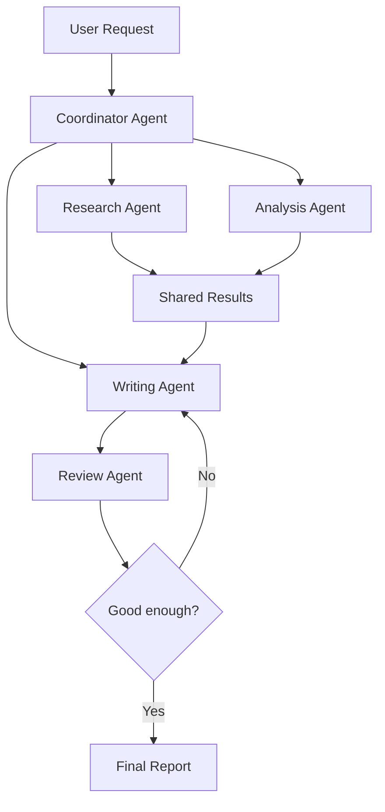

# V11 — Multi-Agent System 🤖🤝🤖

### Multiple AI agents working together to complete a task

---

## 1. What Are We Building?

We are building a system in which multiple specialized AI agents work together to solve a larger problem.

Instead of asking one AI agent to do everything, we divide the work among different agents.

**Example: AI Research and Report System**

Suppose you ask:

"Research Agentic AI and prepare a report about its applications."

We can create several specialized agents:

- **Research Agent:** Finds relevant information.
- **Analysis Agent:** Examines the information and identifies important points.
- **Writing Agent:** Turns the findings into a report.
- **Review Agent:** Checks the report for missing information and errors.

Each agent has a different responsibility, but they work toward the same final goal.

The main idea is:

**Divide the task → Assign responsibilities → Share results → Combine the work.**

## 2. How Does a Multi-Agent System Work?

The coordinator organizes the work. Specialized agents complete their assigned tasks, share their results, and contribute to the final output.

Not every multi-agent system needs all agents to work simultaneously. Some tasks work better when agents complete their work in a particular order.

## 3. Important Concepts

| Concept | Meaning in Simple English |
|---|---|
| Agent | An AI system responsible for a task. |
| Specialized agent | An agent designed for a particular responsibility. |
| Coordinator | Organizes the agents and manages the overall task. |
| Orchestration | Controls how agents work together. |
| Delegation | Assigning a task to another agent. |
| Communication | Passing information or results between agents. |
| Shared state | Information that multiple agents can access during a task. |
| Sequential execution | Agents work one after another. |
| Parallel execution | Independent agents work at the same time. |
| Agent handoff | Passing control or a task from one agent to another. |
| Aggregation | Combining multiple agents' results. |
| Conflict resolution | Handling disagreements between agents. |
| Human approval | Asking a person to review or approve important actions. |

## 4. Different Multi-Agent Architectures

There is no single way to organize multiple agents. The best architecture depends on the task.

| Architecture | How It Works | When Should We Choose It? |
|---|---|---|
| **Sequential Agents** | Agents complete tasks one after another. | When the next agent needs the previous agent's output. |
| **Parallel Agents** | Independent agents work simultaneously. | When different parts of a task can be completed independently. |
| **Coordinator-Based** | One agent assigns tasks and coordinates the others. | When a larger task needs centralized organization. |
| **Hierarchical Agents** | A manager delegates work to other agents, which may have their own teams. | When work can be divided into multiple levels of responsibility. |
| **Agent Handoff** | One agent transfers control to another suitable agent. | When the required specialist changes during a conversation or workflow. |
| **Debate-Based Agents** | Agents produce and critique different answers or viewpoints. | When comparing alternatives or examining a difficult question. |
| **Consensus-Based Agents** | Multiple agents contribute to a shared decision. | When a decision benefits from independent assessments and an explicit agreement process. |
| **Dynamic Team** | The system selects or creates the agents needed for a task. | When tasks vary significantly and a fixed team is insufficient. |

These architectures can be combined. For example, a coordinator can assign two research tasks in parallel, then send their combined results to a writer and reviewer.

## 5. How Do Agents Communicate?

Agents need a way to share information and coordinate their work.

### 5.1 Direct Message Passing

One agent sends its result directly to another.

**Example:** The Research Agent sends its findings to the Writing Agent.

Best for small workflows where the path between agents is clear.

### 5.2 Shared State

Agents read from and write to a common collection of task information.

**Example:** The Research Agent saves its findings in a shared task state, and the Analysis Agent reads them.

Best when several agents need access to the same task context.

### 5.3 Shared Storage

Agents save larger results in files or a database and pass references to those results.

**Example:** A Research Agent saves a detailed report to a file and gives the file location to the Writing Agent.

Best when results are too large to pass directly between agents.

### 5.4 Message-Based Communication

Agents or services exchange messages through a messaging system.

Best when agents run as separate services or need asynchronous communication.

**Important:** Multiple agents do not automatically need a complex communication system. Start with direct message passing or shared state when the workflow is small.

## 6. How Should We Divide Responsibilities?

A common mistake is creating many agents that all perform almost the same task.

Each agent should have a clear purpose.

| Agent | Responsibility | Example Output |
|---|---|---|
| Coordinator Agent | Organizes the task and assigns work. | Task assignments and execution order. |
| Research Agent | Finds relevant information. | Research notes and source references. |
| Analysis Agent | Examines findings and identifies patterns. | Analysis and conclusions. |
| Writing Agent | Produces the requested content. | A report or summary. |
| Reviewer Agent | Checks quality and identifies problems. | Feedback and suggested corrections. |
| Specialist Agent | Handles a specific domain or task. | A specialized result. |

Not every project needs all these agents. Use only the agents that provide a clear benefit.

## 7. Sequential vs. Parallel Execution

These are two important ways to organize agent work.

| Sequential Execution | Parallel Execution |
|---|---|
| Agents work one after another. | Independent agents work at the same time. |
| Useful when tasks depend on earlier results. | Useful when tasks can be performed independently. |
| Easier to understand and debug. | Can reduce waiting time but requires coordination. |
| Example: Research → Analysis → Writing. | Example: Three agents research different topics simultaneously. |

Parallel execution is not always faster. If agents depend on one another, or if the system spends too much time coordinating them, sequential execution may be more effective.

## 8. What Happens When Agents Disagree?

Multiple agents can produce conflicting, incomplete, or incorrect results.

| Problem | Example | Possible Solution |
|---|---|---|
| Conflicting answers | Two agents recommend different approaches. | Compare their evidence and apply defined decision rules. |
| Duplicate work | Two agents research the same topic unnecessarily. | Assign clear responsibilities and track task status. |
| Missing information | One agent fails to return a required result. | Validate outputs and retry when appropriate. |
| Infinite delegation | Agents repeatedly assign work to each other. | Set iteration limits and clear stopping conditions. |
| Poor output quality | The final report contains errors. | Validate the result and use a reviewer or tests. |
| Excessive cost | Too many agents make repeated model calls. | Limit agent count, retries, and unnecessary work. |
| Unsafe actions | An agent attempts a restricted operation. | Enforce permissions and require approval where necessary. |

A multi-agent system should have clear task boundaries, output formats, stopping conditions, and error-handling rules.

## 9. Multi-Agent Systems vs. Related Concepts

| Concept | Main Responsibility | Example |
|---|---|---|
| Single agent | Handles a task using its available tools and instructions. | One agent searches for information and writes a summary. |
| Routing agent | Chooses the appropriate tool, agent, or workflow. | Sends a document question to a RAG system. |
| Planning agent | Decides the steps needed to complete a task. | Plans to research, analyze, and write a report. |
| Multi-agent system | Coordinates multiple agents with different responsibilities. | Separate research, analysis, and writing agents collaborate. |
| RAG | Retrieves relevant information to support an answer. | Finds useful passages in documents. |
| Workflow | Defines the steps and rules that control execution. | Research must finish before writing begins. |

**Remember:** a multi-agent system is not automatically better than a single agent. Use multiple agents when dividing responsibilities genuinely improves the result.

## 10. Multi-Agent Frameworks and Approaches

Frameworks help manage agents, their tools, communication, and execution.

| Framework or Approach | When Should We Choose It, and Why? | Free Availability |
|---|---|---|
| **Custom Python** | When the system has only a few agents and simple communication needs. It provides direct control and is easy to inspect. | Free; no framework required. |
| **LangGraph** | When agents need shared state, conditional workflows, retries, loops, or human approval. | Open-source framework; external services may cost money. |
| **AutoGen** | When exploring conversational collaboration between multiple agents. | Open-source project; check the current project's maintenance and package guidance. |
| **CrewAI** | When organizing agents around roles, tasks, and a coordinated crew. | Open-source framework; hosted services or model APIs may cost money. |
| **OpenAI Agents SDK** | When building agent workflows with tools, handoffs, and tracing using OpenAI models and supported capabilities. | SDK is open source; API usage may cost money. |
| **Semantic Kernel** | When integrating AI agents and orchestration into applications, particularly in Microsoft-oriented environments. | Open-source framework; model and hosting costs may apply. |

These tools overlap, but they emphasize different workflows. Their capabilities, licensing, and maintenance status can change, so check the official documentation before selecting one.

**Important:** Open-source frameworks may be free to use, but the language models, APIs, hosting, and other connected services may require payment.

## 11. How Do We Evaluate a Multi-Agent System?

We need to check both the final result and how the agents work together.

| Evaluation Check | What It Tells Us |
|---|---|
| Task success | Did the system complete the user's request? |
| Output quality | Is the final result accurate and useful? |
| Agent contribution | Did each agent provide useful work? |
| Coordination quality | Were tasks assigned and results combined correctly? |
| Reliability | Does the system handle failures and missing results? |
| Latency | How long did the complete workflow take? |
| Cost | How many model calls and other resources were used? |
| Safety | Were permissions and approval requirements respected? |

For example, compare a single-agent report with a multi-agent report using the same research question. Check whether multiple agents actually improve accuracy, completeness, or quality enough to justify the extra complexity.

## 12. Final Understanding

A multi-agent system allows specialized agents to collaborate on a larger task.

The important ideas are:

- Give every agent a clear responsibility.
- Choose an appropriate way for agents to collaborate.
- Share the information that agents need.
- Validate the agents' results.
- Prevent endless loops and unnecessary work.
- Measure whether multiple agents improve the final result.

**The goal is not to create as many agents as possible. It is to create the smallest effective team that can complete the task well.**